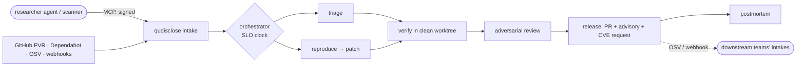
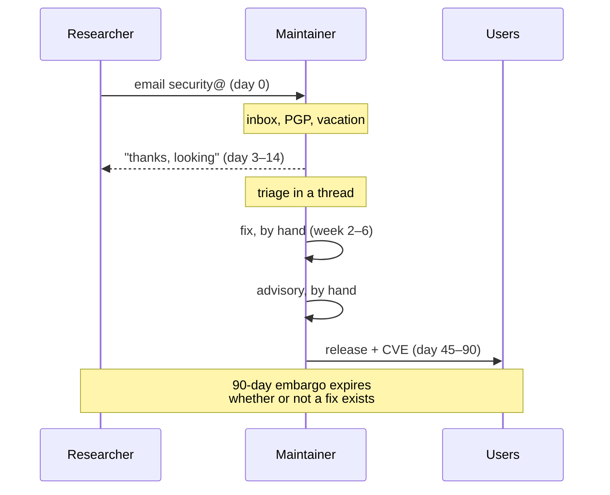
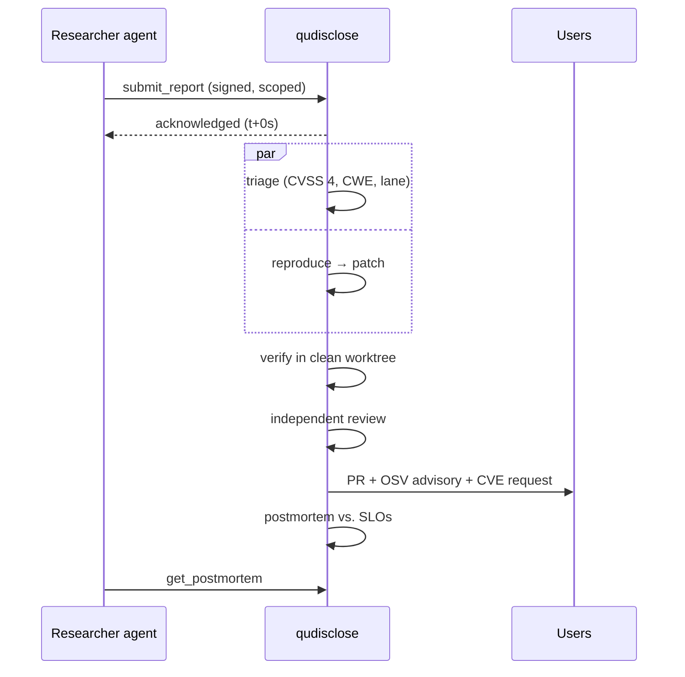
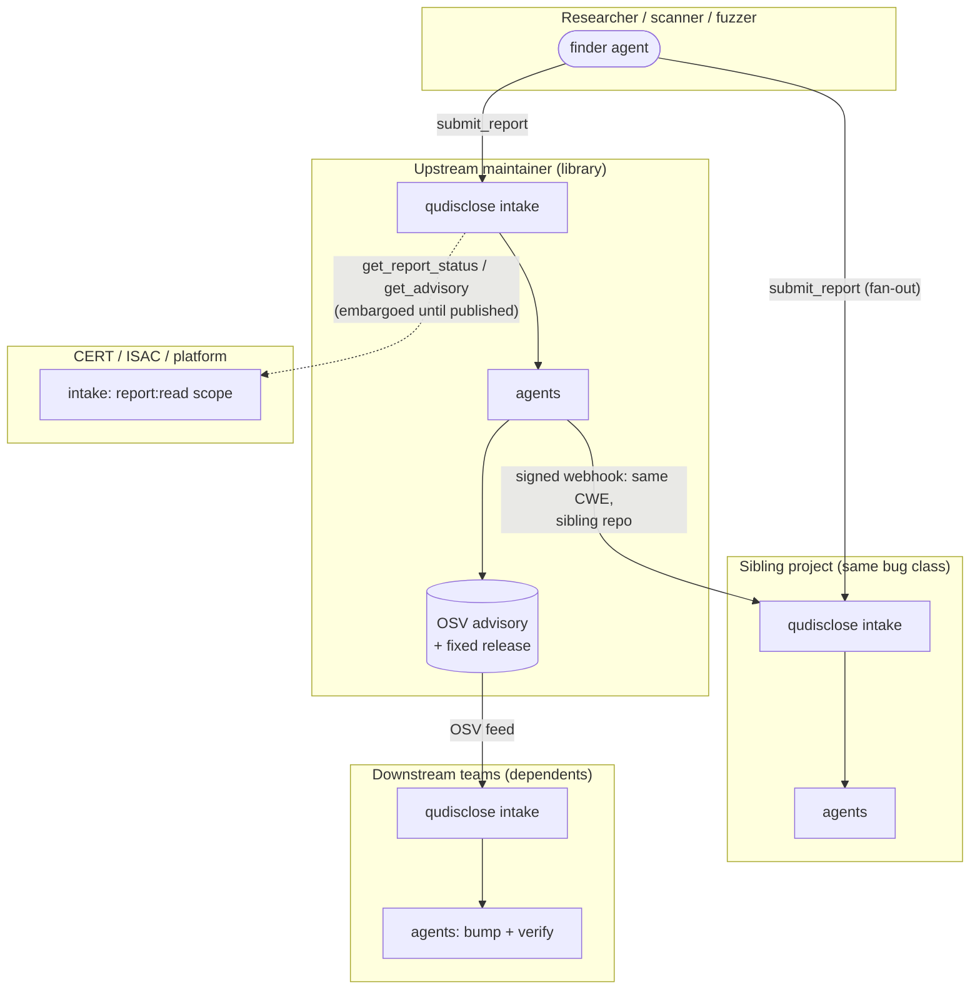
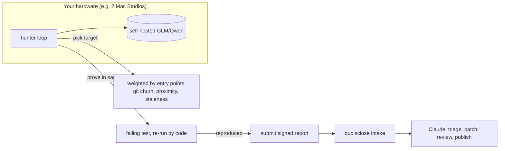

<p align="center">
  <picture>
    <source media="(prefers-color-scheme: dark)" srcset="assets/logo-dark.svg">
    
  </picture>
</p>

<h3 align="center">Coordinated vulnerability disclosure, agent to agent.</h3>

<p align="center">
  A researcher's agent reports over MCP. A maintainer's agent team acknowledges in seconds,<br>
  reproduces, patches, reviews, publishes, and writes the postmortem. No inbox. No 90-day clock.<br>
  Built to the NSA's MCP security design considerations, in code.
</p>

<p align="center">
  
  
  
  
  
  
  
  
</p>

<p align="center">
  <a href="paper/qudisclose.pdf">Paper (PDF)</a> ·
  <a href="#the-old-way-and-the-new-way">Old way vs. new way</a> ·
  <a href="#five-minute-demo">5-minute demo</a> ·
  <a href="#tutorials">Tutorials</a> ·
  <a href="#threat-intel-between-teams">Threat intel between teams</a> ·
  <a href="#always-on-red-teaming-the-hunter">Always-on hunter</a> ·
  <a href="#trust-levels-vsla">VSLA trust levels</a> ·
  <a href="#security-architecture">Security architecture</a> ·
  <a href="#mcp-surface">MCP surface</a>
</p>

---

## The problem

Coordinated vulnerability disclosure was designed for people with inboxes. A researcher writes to `security@`.
Someone reads it, eventually. Triage happens in a thread. A fix lands weeks later. An advisory gets written by
hand. Nobody writes a postmortem. For a solo or small open-source maintainer, **the latency is the vulnerability
window**, and the median open-source fix time is measured in weeks, not hours.

Meanwhile the people finding bugs are increasingly not people. Scanners, fuzzers and research agents produce
findings at machine speed and then wait on a human process that was slow before they arrived.

**qudisclose is the other half of that loop.** It gives a project a machine-to-machine intake, a team of agents
that act on every report immediately and in parallel, and the verification and audit controls that make it
safe to let them.



## The old way and the new way

<table>
<tr>
<th width="50%">Traditional CVD</th>
<th width="50%">qudisclose</th>
</tr>
<tr>
<td>



</td>
<td>



</td>
</tr>
</table>

| | Traditional CVD | qudisclose |
|---|---|---|
| Intake | email, web form, PGP key that expired | MCP tool call with bearer token + Ed25519-signed envelope; GitHub PVR, Dependabot, OSV and signed webhooks pulled automatically |
| Acknowledgement | days | immediate, SLO 15 min |
| Triage | human reads, guesses severity | agent assigns CVSS 4.0 vector, CWE, exploitability, lane; dedups against open cases |
| Reproduction | "can you send a PoC?" | agent writes a failing test; the orchestrator re-runs it and only accepts exit code 1 |
| Fix | when the maintainer has time | starts the moment a failing test exists; verified in a clean worktree; up to 3 attempts |
| Review | the same person who wrote it, if anyone | a fresh context that sees only report + diff + test output and cannot see the patcher's reasoning |
| Embargo | 90 days, fixed | 7 days max, ends the moment the fix publishes |
| Advisory | hand-written, often late | OSV JSON, GitHub repository advisory, CVE request text, changelog, PR body |
| Postmortem | never | every case, success or failure, with time-to-ack/triage/patch/review/publish against targets |
| Credit | sometimes | always, unless the reporter opts out |
| Audit | the email thread | hash-chained, signed log of every tool input and output, verifiable at any time |
| Trust in the report | the sender's reputation | a [VSLA](https://github.com/AAI-Society/vsla) level: signed statement, Merkle-rooted transcript, reproduction re-run by code, platform receipt, countersigned ledger |
| Humans | required at every step | optional: pause, resume, approval gates for merge and publish |

## Five-minute demo

No API key needed. A scripted provider plays all six agents against a deliberately vulnerable package
(`fixtures/vulnpkg`, a path traversal), and everything else is real: sandboxes, verification, publishing,
audit chain, postmortem.

```bash
git clone https://github.com/quome-cloud/qudisclose && cd qudisclose
uv sync --extra dev
uv run qudisclose demo
```

```
intake -> rpt_629430eeeae5 acknowledged
final status: closed
  03:26:35.253 received            agent:researcher-1
  03:26:35.253 acknowledged        orchestrator      {"embargo_until": "2026-11-01 ..."}
  03:26:35.413 triage_done         triage            {"severity": "high", "lane": "hotfix", "cvss": 7.1, "cwe": "CWE-22"}
  03:26:35.564 reproduction_done   reproducer        {"fails_on_vulnerable": true, "test_path": "tests/test_qud_path_traversal.py"}
  03:26:36.487 patch_attempt       patcher           {"attempt": 1, "reproduction_passes": true, "suite_passes": true}
  03:26:36.487 patch_verified      orchestrator
  03:26:36.488 review_done         reviewer          {"approved": true, "required_changes": [], "suspicious": []}
  03:26:36.489 release_plan_ready  release           {"new_version": "1.4.3"}
  03:26:36.494 published           release           {"pr_url": "out/rpt_.../PR.md", "advisory_url": "out/rpt_.../advisory.osv.json"}
  03:26:36.496 postmortem_written  postmortem        {"slo_missed": []}

SLO checks:
  acknowledge       target    15 min  actual     0.0   met=True
  triage            target    60 min  actual     0.0   met=True
  patch_high        target   480 min  actual     0.02  met=True
  review            target    60 min  actual     0.0   met=True
  publish_after_fix target    60 min  actual     0.0   met=True

POSTMORTEM
  went well:  Acknowledged instantly at intake
              Reproduction and triage ran in parallel
              Fix verified by code in a clean worktree, not by the model's say-so
              Independent review approved on first pass
  went badly: Nothing notable
  actions:    Add a fuzz target for resolve_path to CI
              Document the storage-root contract in the README
              Consider enabling require_human_for_publish until trust in automation is established

audit chain: OK (8 entries)
```

Then `uv run pytest -q` runs the suite (91 tests; the Postgres parity test skips when no local Postgres is reachable), including the paths you hope never to see: a patch that fails
verification three times, a reviewer that rejects and sends the patcher back, a human pausing mid-triage, a
report that tries to prompt-inject the agents.

## Tutorials

1. [Deploy for your repository](#1-deploy-for-your-repository)
2. [Submit as a researcher agent](#2-submit-as-a-researcher-agent)
3. [Use any MCP client, including Claude Code](#3-use-any-mcp-client-including-claude-code)
4. [Operate it: status, pause, approve, audit](#4-operate-it-status-pause-approve-audit)
5. [Wire up the feeds: GitHub, Dependabot, OSV, webhooks](#5-wire-up-the-feeds)
6. [Tune the policy: SLOs, embargo, human gates, models](#6-tune-the-policy)
7. [Threat intel between teams](#threat-intel-between-teams)
8. [Always-on red-teaming with a self-hosted model](#always-on-red-teaming-the-hunter)

### 1. Deploy for your repository

```bash
uv run qudisclose init --repo your-org/your-repo --path /srv/checkouts/your-repo \
    --test-command "uv run pytest -q"
```

This writes `qudisclose.json` and three Ed25519 identities under `keys/`: the **server** key (signs the tool
catalog so clients can pin it), the **issuer** key (signs bearer tokens) and the **audit** key (signs the audit
chain; the agents never touch it).

Set credentials. Claude is reached through the official SDK, so either an API key or an `ant auth login`
profile works. The GitHub token is only ever handed to agents as short-lived, single-purpose leases.

```bash
export ANTHROPIC_API_KEY=sk-ant-...
export QUDISCLOSE_GITHUB_TOKEN=github_pat_...   # contents:write, pull_requests:write, repository_advisories:write
```

The store is **PostgreSQL** by default (`"db_dsn": "postgresql:///qudisclose"` in the config); the database
is created on first run if it does not exist. SQLite is used only for the offline demo and the tests. Point
`db_dsn` at your Postgres (`postgresql://user:pw@host/qudisclose`).

Edit `qudisclose.json` to taste (see [Tune the policy](#6-tune-the-policy)), then run the long-lived
processes: the MCP server, a poller for the feeds, and optionally the always-on hunter.

```bash
uv run qudisclose serve                      # MCP intake on http://127.0.0.1:8765/mcp
*/10 * * * *  uv run qudisclose ingest       # cron: GitHub advisories, Dependabot, OSV
uv run qudisclose hunt                        # always-on red-teaming (see tutorial 8)
```

Put TLS in front of it (Caddy, nginx, a cloud load balancer) and set `public_url` to the HTTPS address;
tokens are bound to that audience. The server refuses unauthenticated requests with 401 and publishes
OAuth protected-resource metadata at `/.well-known/oauth-protected-resource/mcp`.

### 2. Submit as a researcher agent

A reporter is a **non-human identity**: an Ed25519 key pair pinned by the maintainer, plus a bearer token
scoped to `report:submit` and `report:read`. The maintainer registers it once:

```bash
uv run qudisclose register-reporter agent:researcher-1 --generate ./reporter-keys
#   generated reporter key -> reporter-keys/agent:researcher-1.json
#   registered agent:researcher-1; bearer token (ttl 2592000s):
#   eyJhbGciOiJFZERTQSIs...
```

and hands the key file and token to the researcher. (If the researcher already has a key, pass
`--public-key <hex>` instead of `--generate`.)

The researcher's side, from the CLI:

```bash
cat > report.json <<'EOF'
{
  "title": "Path traversal in vulnpkg.files.resolve_path allows reading arbitrary files",
  "description": "resolve_path joins the caller-controlled user_path onto storage_root with no normalization...",
  "repo": "example/vulnpkg",
  "package": "vulnpkg",
  "affected_versions": ["<1.4.3"],
  "proof_of_concept": "read_user_file('/srv/storage/alice', '../../etc/passwd')",
  "cwe": "CWE-22",
  "cvss_vector": "CVSS:4.0/AV:N/AC:L/AT:N/PR:L/UI:N/VC:H/VI:N/VA:N/SC:N/SI:N/SA:N",
  "reporter_contact": "researcher@example.org",
  "wants_credit": true
}
EOF

uv run qudisclose submit report.json \
    --url https://cvd.example.org/mcp --token "$TOKEN" \
    --key reporter-keys/agent:researcher-1.json --wait 60
```

```
catalog fingerprint 9191cff6590348054d34b6775ee619180ad46fe43d4545e6564d34b71dc75ad4
{ "report_id": "rpt_f5b339dd4798", "new": true, "status": "acknowledged", "embargo_until": "2026-11-01T03:28:32Z", ... }
  status=triaging
  status=closed
{ "postmortem": { "outcome": "published", "went_well": [...], ... } }
```

Or from Python, inside the researcher's own agent:

```python
import asyncio
from qudisclose.client import ReporterClient
from qudisclose.models import ReportSubmission
from qudisclose.security import Identity

async def main():
    me = Identity.load("reporter-keys/agent:researcher-1.json")
    async with ReporterClient("https://cvd.example.org/mcp", TOKEN, me,
                              pinned_server_key=SERVER_PUBKEY_HEX,       # trust chain
                              pinned_fingerprint=CATALOG_FINGERPRINT) as c:   # rug-pull protection
        res = await c.submit(ReportSubmission(title=..., description=..., repo="example/vulnpkg"))
        print(await c.status(res["report_id"]))

asyncio.run(main())
```

The client verifies the server's signed catalog fingerprint on connect and refuses to operate if the tool
catalog or the server key differs from what it pinned. Every mutating call carries a signed envelope with a
nonce and a 2-minute expiry, so a captured request cannot be replayed or altered.

Submissions are **idempotent on content**: the same finding submitted twice (or by two different agents)
returns the same case id with `"new": false`, and the duplicate is recorded on the case's timeline.

### 3. Use any MCP client, including Claude Code

Read-only tools work from any MCP client with a bearer token:

```bash
claude mcp add --transport http cvd https://cvd.example.org/mcp --header "Authorization: Bearer $TOKEN"
```

Then, in Claude Code: *"Read `qudisclose://policy` from the cvd server and summarize the SLOs"*, or
*"What's the status of rpt_f5b339dd4798?"*.

Mutating tools need the signed envelope. Generic clients cannot set MCP `_meta`, so the envelope is also
accepted as an `envelope` argument, and `qudisclose sign` produces one:

```bash
echo '{"report": {...}}' | uv run qudisclose sign submit_report --key reporter-keys/agent:researcher-1.json
```

An agent with shell access can do this itself: *"Sign these arguments with `qudisclose sign submit_report`,
then call `submit_report` with the report and the resulting `envelope`."* The server verifies the envelope
against the other arguments, strips it, and runs the tool.

### 4. Operate it: status, pause, approve, audit

The maintainer is not in the loop by default, but every lever exists, both as CLI commands and as MCP tools
gated by the `admin` scope (so an operator's own agent can use them).

```bash
uv run qudisclose status                    # all cases
uv run qudisclose status rpt_f5b339dd4798   # one case: timeline, every artifact
uv run qudisclose control pause  rpt_f5b339dd4798 --reason "want eyes on this one"
uv run qudisclose control resume rpt_f5b339dd4798
uv run qudisclose control approve rpt_f5b339dd4798   # when policy requires a human for merge/publish
uv run qudisclose audit --show rpt_f5b339dd4798      # verify the signed hash chain
```

```
chain: OK (ok); 17 entries
    1 2026-10-25T03:28:32 agent:researcher-1   intake.accepted       rpt_f5b339dd4798
    2 2026-10-25T03:28:32 agent:researcher-1   tool.submit_report    rpt_f5b339dd4798
    4 2026-10-25T03:28:32 agent:triage         triage.result         rpt_f5b339dd4798
    6 2026-10-25T03:28:32 agent:reproducer     reproducer.result     rpt_f5b339dd4798
    7 2026-10-25T03:28:33 agent:patcher        patcher.result        rpt_f5b339dd4798
    8 2026-10-25T03:28:33 agent:reviewer       reviewer.result       rpt_f5b339dd4798
   10 2026-10-25T03:28:33 release              release.published     rpt_f5b339dd4798
   14 2026-10-25T03:29:04 agent:researcher-1   tool.denied
```

Entry 14 is a reporter trying to call `pause_case`. Denials are audited too.

**qudisclose never merges a PR.** The release step opens the pull request and the draft advisory and stops; a maintainer reviews the diff on GitHub and clicks merge. By default (`require_human_for_merge: false`) the PR opens automatically once the patch has passed reproduction, the test suite and review — you see it and merge it. Set the flag to `true` to add a second checkpoint: qudisclose then won't even open the PR until you run `qudisclose control approve <id>`.

A pause takes effect at the next stage boundary; the case parks as `paused` and resumes exactly where it
stopped. Every case ends in a postmortem, and a case that fails (could not reproduce, no verified patch,
review rejected) is a postmortem that tells you why, which is the moment a human is actually needed.

To mint a token for an operator agent:

```bash
uv run qudisclose token ops-agent --scopes admin,report:read --ttl 3600
```

### 5. Wire up the feeds

`qudisclose ingest` polls every configured source once and runs new cases; cron it. All sources normalize to
the same `Report` and dedup by `(source, external id)` and by content hash.

| Source | What it pulls | Notes |
|---|---|---|
| GitHub private vulnerability reports and repository advisories | `GET /repos/{o}/{r}/security-advisories?state=triage,draft` | reporter = the GitHub login, credited on the advisory |
| Dependabot | `GET /repos/{o}/{r}/dependabot/alerts?state=open` | severity filter; no embargo (already public) |
| OSV.dev | `POST /v1/query` per `(ecosystem, package)` | public, no embargo; this is how downstream teams learn of your fixes |
| Signed webhooks | huntr, HackerOne, Intigriti, OSS-Fuzz, your CI's sanitizer job | HMAC-SHA256 over `"{timestamp}.{body}"`, 5-minute window, strict schema |

Add the OSV ecosystem and package name to a repo entry to enable the OSV feed:

```json
"repos": {
  "your-org/your-repo": { "path": "/srv/checkouts/your-repo", "test_command": "uv run pytest -q",
                          "ecosystem": "PyPI", "package": "your-package" }
}
```

A webhook sender signs like this (Python shown; it's two lines in any language):

```python
from qudisclose.ingest import SignedWebhookSource
signature, timestamp = SignedWebhookSource.sign(SHARED_SECRET, body_bytes)
# POST https://cvd.example.org/webhooks/huntr  with headers X-Qud-Signature and X-Qud-Timestamp
```

Webhook secrets go in the config as `"webhook_secrets": {"huntr": "$HUNTR_SECRET"}`; `$VAR` values are
read from the environment at load time, never stored.

### 6. Tune the policy

Everything a team would argue about lives in `qudisclose.json` under `policy`, and is published to reporters
as the `qudisclose://policy` resource so they know the rules before they submit.

```json
"policy": {
  "embargo_days_max": 7,              // hard cap; traditional CVD says 90
  "publish_on_fix": true,             // embargo ends the moment the fix ships
  "speculative_patching": true,       // reproduce + patch start at acknowledgement, in parallel with triage
  "require_human_for_merge": false,   // default: PR opens automatically; a human reviews + merges on GitHub. true = also require `control approve` before the PR is opened
  "require_human_for_publish": false, // the advisory is created as a GitHub draft either way (humans publish it)
  "max_patch_attempts": 3,
  "credit_reporters": true,
  "slo": { "acknowledge": 15, "triage": 60, "patch_critical": 240, "patch_high": 480,
           "patch_medium": 1440, "patch_low": 10080, "review": 60, "publish_after_fix": 60 }
},
"model": "claude-opus-5-5",           // every role; effort is set per role (reviewer and patcher run at xhigh)
"provider": "anthropic"               // or "scripted" to run without a model
```

A missed SLO never blocks the pipeline. It is recorded as an event and lands in the postmortem's
*went badly* list, which is where you find out your patch target is unrealistic for a 200k-line repo, or that
your test suite takes 40 minutes.

## Threat intel between teams

Disclosure is rarely one researcher and one maintainer. A finding in a library affects everyone who depends on
it; a bug class found in one project is usually present in its siblings; a CERT or ISAC wants to know what's
coming. Today that coordination is email threads and spreadsheets with embargo dates. With every party running
an intake, it becomes agents talking to agents.



**How each hop works with what ships today**

| Hop | Mechanism | What crosses the boundary |
|---|---|---|
| Finder → maintainer | `submit_report` over MCP (signed, scoped) | the report; the reporter's identity and public key; credit preference |
| Finder → many maintainers | the same `ReporterClient` against each project's intake; each returns its own case id | one finding, N independent cases, each with its own SLO clock and embargo |
| Maintainer → sibling project | the maintainer's agent forwards through the sibling's **signed webhook** intake (`SignedWebhookSource`), or, if the sibling pins the maintainer's key, through `submit_report` with a reporter token | the normalized report (title, description, CWE, affected versions, PoC); the forwarding project is the reporter of record |
| Upstream → downstream | upstream publishes an OSV-format advisory and a fixed version; downstream's `OSVSource` poller picks it up as a `public` report; downstream's own pipeline turns it into a dependency bump, verified by its own test suite | only public data; no embargoed detail leaves the upstream deployment |
| Any party → CERT / coordinator | a `report:read` token on the maintainer's intake: `get_report_status`, `get_advisory`, `get_postmortem`, `get_audit_trail` | status, SLO state, severity and the *existence* of a fix; advisory details stay embargoed until published, enforced by the server, not by etiquette |
| Coordinating an embargo across parties | `set_embargo` (scope `triage:write`) on each intake, capped by each project's `embargo_days_max`; `publish_on_fix` means the earliest fix is the de-facto release date | a deadline, and an audited record of who set it |

**What this changes for a team**

- *Embargo is a server-enforced classification, not a promise.* A case is `embargoed` until the moment
  `published` is recorded. Until then `get_advisory` returns only `{"available": true, "embargoed": true,
  "fixed_version": ...}` and `list_reports` shows `[embargoed]` in place of titles. A coordinator with a read
  token learns that a fix exists and when it lands, without learning what the bug is.
- *Every party keeps its own audit chain.* When two teams disagree about who knew what when, each has a signed,
  hash-chained log of every tool call in and out, with timestamps, that the other side can verify with the
  published audit public key.
- *Postmortems compose.* Each intake writes its own; the action items (fuzz target, missing test, bad SLO)
  stay with the team that owns them, and the downstream postmortem will say "upstream advisory landed at T,
  our bump merged at T+22 min", which is the number an ISAC actually wants.
- *The finder is a first-class, revocable identity.* A scanner that starts flooding gets rate-limited per
  identity and its token revoked, without affecting anyone else. A researcher who asked for credit gets it on
  every advisory, from every project they fanned out to.

A worked example, end to end, with two intakes on one machine:

```bash
# upstream library
uv run qudisclose --config up.json init --repo acme/libparse --path ./libparse --provider scripted
# downstream app that depends on it, with the OSV feed on
uv run qudisclose --config down.json init --repo acme/app --path ./app --provider scripted
#   (edit down.json: repos.acme/app.ecosystem="PyPI", .package="libparse")

uv run qudisclose --config up.json serve &                     # researcher submits here
uv run qudisclose submit finding.json --url http://127.0.0.1:8765/mcp --token $T --key researcher.json --wait 30
#   -> upstream publishes advisory + fixed 2.3.1
uv run qudisclose --config down.json ingest                    # downstream polls OSV, opens its own case, bumps, verifies
uv run qudisclose --config down.json status                    # a new case with source "osv", run by downstream's own agents
```

## Always-on red-teaming (the hunter)

Intake is reactive: it waits for a report. The **hunter** is the proactive half — a loop that keeps looking
at an authorized codebase, feature by feature, and turns reproducible findings into signed reports that flow
through the same pipeline. It is built to run 24/7 on a **self-hosted** model (GLM or Qwen via Ollama, vLLM or
llama.cpp), so your source never leaves your hardware, while Claude does the patching once a report lands. A
cheap model hunts constantly; the expensive model is spent only on confirmed, reproduced findings.



Three rules keep an always-on model useful instead of noisy:

1. **It never escalates a guess.** Every lead is proven with a failing test in a sandbox, and that test is
   re-run by code before anything is submitted. The failure must be an assertion-style security failure, not a
   broken test (a missing import that happens to fail is rejected).
2. **It does not look at files at random.** Targets are weighted toward reachable surface (HTTP handlers,
   parsers, deserialization, auth, path handling), recent git churn, and proximity to past findings, and a
   coverage map in the store stops it re-walking the same code.
3. **Its output is untrusted input.** Reports enter through the normal intake and are independently
   re-reproduced and reviewed downstream; the hunter's say-so is only a lead.

Configure the self-hosted node and run the loop:

```json
"hunter": {
  "enabled": true,
  "endpoint": "http://localhost:11434/v1",   // Ollama / vLLM / llama.cpp, OpenAI-compatible
  "model": "qwen3.8:27b",                     // or a self-hosted GLM
  "submit": "local",                          // "local" in-process, or "mcp" (signed, over the wire)
  "interval_seconds": 30,
  "authorized_targets": ["your-org/your-repo"],   // required: the hunter refuses to start for any other repo
  "authorization_basis": "ownership"              // ownership | program | engagement | safe-harbour (VSLA-F-19)
}
```

```bash
uv run qudisclose hunt --repo your-org/your-repo          # loops forever; Ctrl-C to stop
uv run qudisclose hunt --iterations 5 --interval 0 --max-findings 1   # bounded run
```

For a distributed setup, the hunter runs on your inference box and submits to qudisclose over MCP as a scoped,
signed reporter (`"submit": "mcp"` with a reporter key and token), exactly like any external researcher. Run
the offline, scripted version first to see the whole loop without a model:

```bash
# in a config with "provider": "scripted"
uv run qudisclose hunt --iterations 2 --interval 0
#   [hunt] vulnpkg/__init__.py    no hypotheses
#   [hunt] vulnpkg/files.py       ESCALATED -> rpt_45ee51e8   (then patched and closed)
```

Only ever point the hunter at code you own or are authorized to test. `authorized_targets` is the operator's own guard
for that (slugs, repository URLs or checkout paths; the hunter refuses to start otherwise). VSLA records the authorization
basis in every statement but cannot enforce it, and nothing in the framework constrains a hunter that never discloses.
The MBOM for a self-hosted hunter carries a digest of the loaded weights only when `inference.weights_path` names the
weight file; otherwise it says `unmeasured: true` rather than invent one.

### Self-hosted inference, even when code runs in a Quome sandbox

The rule is **code is generated locally, only code runs in the sandbox.** The agents call the model
in-process on your hardware (Ollama/vLLM serving Qwen/GLM on a Mac Studio); the sandbox is only ever
used to *execute* code, so its RAM never has to hold a model. With the `quome` sandbox backend, the
model still never enters the sandbox — a test pins the sandbox contract to nine code-execution methods
so no inference capability can leak in.

If a consumer *inside* a sandbox ever needs the model (a future in-sandbox agent), reach it through the
authenticated bridge rather than exposing Ollama — which has no auth of its own:

```bash
ollama serve                                               # model on your host, :11434
export QUDISCLOSE_INFERENCE_TOKEN=$(openssl rand -hex 32)  # or set inference.oidc_issuer
qudisclose infer-bridge serve                              # token-gated proxy on :8900 (fails closed)
ngrok http 8900                                            # expose the bridge → inference.public_url
```

The bridge verifies an EdDSA token from your OIDC issuer (short-lived,
single-audience, revocable) on every request, falling back to a static shared secret when no issuer is
configured. `QuomeSandbox.inject_inference()` drops an OpenAI-compatible client config into the sandbox
so an in-sandbox consumer points at the bridge URL with a token — one authenticated hop back to your
host, with the model staying on your hardware. See
[`docs/design/2026-10-25-local-inference-bridge.md`](docs/design/2026-10-25-local-inference-bridge.md).

## Trust levels: VSLA

A signed email proves who sent a report. It does not prove the bug is real, that the model named did the
work, that the account of the work is complete, or when the maintainer actually received it. For machine-to-machine
disclosure those are the facts a receiver decides on, so qudisclose implements
[**VSLA**](https://github.com/AAI-Society/vsla) (Vulnerability-disclosure Supply-chain Levels for Agents, v1.0
revision 2), the SLSA-shaped framework for disclosures: a ladder of levels, an in-toto/DSSE provenance statement, a
threat model, a verification procedure and a trust score. The framework, paper and reference verifier live in the
sibling repo; this is the implementation, and `tests/test_vsla_interop.py` holds it byte-compatible with the reference
(RFC 8785 canonical JSON, DSSE receipts and ledger entries, the same Merkle and ledger roots, the same level on the same inputs).

<p align="center"></p>

qudisclose plays **both roles**:

- **As a finder**, it attests every case it verifies. The moment its own re-run of the reproduction test fails per the
  normative classifier it signs a **Finding** statement; once a diff has passed reproduction, the suite and the review it
  signs a **Patch** statement. Each binds the report digest and the git commit the case ran against, an authorization
  basis, a model bill of materials (every role's model, family, provider and serving mode; for a self-hosted model the
  SHA-256 of the loaded weight file when `inference.weights_path` names it, else `unmeasured: true`; the model name is
  never hashed), an RFC 6962 Merkle root whose leaf 0 is the measured harness and whose `verify` leaf matches the
  reproduction section, the reproduction evidence with the sandbox's isolation class, and on the Patch track the diff's
  `scope` (`source-only` or `mixed`). Every statement is produced in the **embargoed profile** (test path, command and
  files touched as digests) and the **published profile** (plaintext); only the embargoed one leaves the platform until
  the case is public.
- **As a platform**, it verifies statements that reporters submit (`attestation` on `submit_report`): signature under the
  pinned reporter key, schema, Merkle root and verify leaf against the supplied leaves, subject against the report, then
  its own **re-execution at the subject revision** in a clean sandbox it controls, classified with its own classifier
  (`security/sandbox.py`: pytest junit, assertion failures only, no collection errors), with a coverage/import check that
  the test touched the package the report names. For a Patch statement it applies the diff, runs the reproduction and
  the suite, computes the scope from the diff and runs its **own adversarial review** on a reviewer whose model family
  must differ from every patcher in the MBOM (`inference.reviewer_provider`); the finder's own review never counts. It
  signs a **DSSE receipt** in every case (`status` in `matched`, `mismatched`, `environment-error`, `timeout`,
  `not-attempted` under admission control), checks the finder's handed-over **ledger** entry by entry under the
  countersigners it pins, stores the last root it saw and records `ledger-fork` on a history that does not extend it, and
  when the case closes **countersigns the outcome** per track into the reporter's ledger: `accepted` only when the fix
  shipped, `reproduced-unresolved` when it reproduced but did not resolve, `rejected`/`false-positive` with a reason, and
  nothing when its own sandbox was the reason. A thin or unverifiable ledger lowers a claim to L1; a bad signature makes
  it L0; neither ever blocks the report.

<p align="center"></p>

```bash
uv run qudisclose demo
#   ... vsla_attested  {"track": "finding", "claimed": 1, ...}
#   ... vsla_attested  {"track": "patch", "claimed": 1, ...}
#   ... vsla_ledger_appended  {"finder": "agent:researcher-1", "track": "finding", "outcome": "accepted", ...}
#   VSLA: finding claimed L1 · patch claimed L1 · profile embargoed · authorization ownership · sandbox local/process · patch scope source-only
uv run qudisclose attest rpt_...                            # statements (both profiles), leaves, receipt and verification for a case
uv run qudisclose verify-attestation out/rpt_.../vsla.finding.json --leaves leaves.json --key keys/attestation.json \
    [--receipt receipt.json] [--ledger ledger.json] [--expectations exp.json] [--last-seen ROOT:COUNT]
#   VSLA finding: claimed L1, verified L1   (+ every check E1..E8, I1..I5, N1..N3, each marked external or structural)
```

What the levels mean here, and what is honestly implemented:

| Level | Requires | qudisclose |
|---|---|---|
| **L1 Attested** | signed statement, authorization basis, MBOM, Merkle transcript with measured leaf 0, reproduction by code with the normative classifier | every verified case, both tracks, both profiles |
| **L2 Trusted** | authoritative channel, platform receipt after re-execution at the subject revision (plus review on a distinct family and `source-only` scope on the Patch track), a ledger countersigned by pinned keys over the floor (score, entries, countersigners, 30-day age gate) | receipts, re-execution, review, scope and the ledger are implemented and verified byte-compatibly with the reference. L2 is *earned*: a deployment's own statements claim L1 until other platforms' countersigned outcomes accumulate in its ledger and it hands them over. The default local sandbox is isolation class `process`, a development convenience named as such in every receipt; a production intake needs the `quome` backend (`vm`). |
| **L3 Hardened** | weights, harness, policy, sandbox and signing key in an attested environment; every model self-hosted and provider-attested | a pluggable attestor with the spec's reference `signed-quote` form bound to enclave key, harness, weights and sandbox (`vsla.environment_evidence_path`); an API-served model (the default Claude configuration) caps the Environment pillar at L2; SEV-SNP/TDX quote verification is not claimed |

The verified level is recorded on the case (`report.vsla`), in the `vsla_verified` event, in the audit chain and in
the ledger entry, so an over-claiming finder and an over-granting platform are both visible. The verified level does not
open a PR by itself: the lane and the human gates in the policy still decide that. Floors, the isolation class, admission
limits, pinned countersigners and keys are published in the `qudisclose://policy` resource (`vsla` block); the
deployment's finder key is `keys/attestation.json`, and a deployment with VSLA enabled refuses to start on an ephemeral
platform key (`vsla.allow_ephemeral_platform_key` is for demos). Until a case is public, its status, lane, timing,
timeline and test details are visible only to the submitting reporter and to admins, and `get_ledger` returns only the
caller's own entries.

<p align="center"></p>

Configuration (`qudisclose.json`):

```json
"vsla": {
  "enabled": true,
  "operator": "example.org",                   // accountable org in every statement; defaults to the intake host
  "authorization_basis": "ownership",          // ownership | program | engagement | safe-harbour (recorded, not enforced)
  "authorization_ref": null,
  "floor": 0.6, "min_entries": 5, "min_countersigners": 2, "min_age_days": 30,   // the L2 floor (spec: trust-rubric.md v1.1)
  "pinned_countersigners": {"platform:cvd.other.org": "ed25519:..."},             // whose ledger entries count toward n and m
  "trusted_providers": {}, "trusted_roots": {}, "trusted_operators": {},
  "expectations_path": null,                   // extra harness digests / measurement allowlist (VSLA-V-6); own harness is always expected
  "reexec_per_identity_per_hour": 20, "reexec_concurrent": 2, "reexec_unknown_identities": true,   // admission control
  "require_leaves": false,
  "environment_evidence_path": null,           // reference signed-quote evidence -> L3 claimed (see vsla/environment.py)
  "allow_ephemeral_platform_key": false
},
"inference": { "weights_path": null, "reviewer_provider": null, "reviewer_model": null, ... },
"hunter": { "authorized_targets": ["your-org/your-repo"], "authorization_basis": "ownership", ... }
```

`tests/test_vsla.py` pins the behaviour by requirement id ([`docs/vsla-requirements-map.md`](docs/vsla-requirements-map.md)),
and `tests/test_vsla_interop.py` checks that qudisclose's statements, receipts and ledger entries verify under the
reference verifier and that the reference examples verify here.

## Security architecture

The NSA's May 2026 Cybersecurity Information Sheet, *Model Context Protocol (MCP): Security Design
Considerations for AI-Driven Automation* (U/OO/6030316-26), treats an MCP deployment as a continuum in which
the model, client, server and tools share one effective trust domain. Each of its design considerations maps
to a class here and a test that proves it. The full mapping is in [`docs/nsa-mcp-controls.md`](docs/nsa-mcp-controls.md).

| Consideration | Implementation |
|---|---|
| Per-message cryptographic integrity, replay protection | `SignedEnvelope`: Ed25519 over `{sender, tool, args_hash, nonce, iat, exp}`, 2-min TTL, nonce cache |
| Least privilege at the tool-call boundary | one required scope per tool; EdDSA JWTs with audience and short TTL; denials audited |
| No long-lived credentials in agent context | `CredentialBroker` leases: purpose + repo + holder + TTL; the PR and the advisory use separate leases, revoked after use |
| Distinct non-human identities | Ed25519 identity per agent, reporter and server; per-identity rate limits and token revocation |
| Tamper-evident audit of inputs *and* outputs | `AuditLog`: hash chain + Ed25519 signature per entry, secrets redacted first, agents never hold the key |
| Trust chain, tool-catalog pinning | server signs its catalog fingerprint; clients pin key and fingerprint and refuse on drift |
| Tool output as untrusted input | `InjectionScanner` + `wrap_untrusted` on every report, diff and test output before it reaches a model |
| Strict deserialization | every tool input is a pydantic model with `extra="forbid"` and size caps |
| Sandboxed execution | pluggable backend (`sandbox.backend`): **local** — git worktree per case, scrubbed env, rlimits, `unshare -n` on Linux, path confinement, command allowlist; **quome** — each case runs in an isolated [Quome](https://github.com/quome-cloud/quome-sdk-python) sandbox VM (egress killswitch, east-west guard, metadata guard), so a self-hosted Quome host keeps source on your hardware |
| Verification independent of the model | the orchestrator re-runs the failing test, applies each patch in a clean worktree and runs the suite; the reviewer never sees the patcher's rationale |
| Human-in-the-loop where policy demands | `pause_case`, `resume_case`, `approve_release`; broker gates for merge and publish |

## MCP surface

| Tool | Scope | Signed | Notes |
|---|---|---|---|
| `catalog_fingerprint` | – | | signed SHA-256 of the catalog; pin it |
| `submit_report` | `report:submit` | ✓ | idempotent on content; starts the pipeline |
| `get_report_status` | `report:read` | | timeline, SLO checks, artifact list |
| `list_reports` | `report:read` | | for embargoed cases, only the submitting reporter and admins see status, lane, severity and timing |
| `get_advisory` | `report:read` | | OSV advisory once published; fixed version only while embargoed |
| `get_postmortem` | `report:read` | | |
| `get_audit_trail` | `report:read` | | signed chain entries + verification result |
| `get_attestation` | `report:read` | | VSLA Finding/Patch statements (embargoed profile until public), leaves (once public), receipt and verification (reporter/admin) |
| `get_ledger` | `report:read` | | the caller's countersigned trust ledger (DSSE entries) and rubric score; other finders need `report:admin` |
| `acknowledge_report`, `set_embargo` | `triage:write` | ✓ | |
| `pause_case`, `resume_case`, `approve_release` | `admin` | ✓ | |

Resources: `qudisclose://policy` (includes the `vsla` block: keys, floors, isolation class, admission limits, pinned countersigners), `qudisclose://reports/{id}`, `qudisclose://advisories/{id}`,
`qudisclose://postmortems/{id}`, `qudisclose://attestations/{id}`.

Signed tools take the envelope in `_meta["qudisclose/sig"]` or as an `envelope` argument.

## The agents

| Role | Sees | Produces | Effort |
|---|---|---|---|
| Triage | the report (wrapped as untrusted), open case titles | CVSS 4.0 vector + score, CWE, exploitability, lane, duplicate, `injection_suspected` | high |
| Reproducer | sandbox tools (list, read, write, run) | one failing test; the orchestrator re-runs it and requires exit code 1 | high |
| Patcher | sandbox tools + the failing test + prior feedback | a unified diff; verified by code, up to 3 attempts | xhigh |
| Reviewer | report, diff, test output. **Not** the patcher's summary or reasoning | binding verdict with required changes | xhigh |
| Release | triage, diff, current version | semver bump, changelog, PR body, OSV advisory, CVE request | medium |
| Postmortem | full timeline, computed SLO checks, every artifact | went well / went badly / action items | medium |

All roles run on `claude-opus-5-5` through the Anthropic SDK with adaptive thinking and server-side refusal
fallbacks. Swap in `"provider": "scripted"` to run the identical pipeline without a model.

## Layout

```
src/qudisclose/
  server.py        MCP intake + GuardMiddleware (identity, rate limit, scope, envelope, audit)
  client.py        reporter client with trust pinning
  orchestrator.py  state machine, speculative parallelism, code-side verification, SLO clock
  agents/          provider (Anthropic / self-hosted / scripted), prompts, roles, sandbox tools
  hunter.py        always-on red-team loop: target selection, reproduce-before-escalate, coverage map
  ingest/          GitHub advisories, Dependabot, OSV, signed webhooks
  security/        keys, envelope, audit, tokens, catalog, scanner, broker, ratelimit, sandbox
  vsla/            VSLA: merkle, dsse (statements + receipts), transcript recorder, attestor, verifier, ledger + rubric, environment adapters
  publisher.py     LocalPublisher (files) / GitHubPublisher (PR + repository advisory via leases)
  db.py            backend: PostgreSQL (production) / SQLite (tests, demo)
  policy.py · config.py · store.py · models.py · cli.py · demo.py
fixtures/vulnpkg   deliberately vulnerable package for the demo and tests
docs/              design spec · NSA control mapping
paper/             qudisclose.tex → qudisclose.pdf (tectonic) · figs/ (built in the vsla repo)
assets/            logo · vsla/ figures (built in the vsla repo)
```

## Status and honesty

This is a v0.1 built against the MCP 2.x Python SDK and the Anthropic SDK 2.x. Implemented and tested: the
pipeline, the HTTP server with JWT auth and signed envelopes, the feeds, the GitHub publisher, the PostgreSQL
and SQLite backends (a parity test runs the full pipeline on Postgres), and the always-on hunter. The hunter
has been run end to end against a self-hosted `qwen3.8:27b` on Ollama: it found a planted path traversal,
wrote a passing-then-failing test that cleared independent verification, and escalated it into the pipeline.
The live Claude patch path is exercised against a recording fake client and has the request shape the SDK
documents, but you should run one real case before trusting it with your repo. Production notes
(container-per-deployment, audit storage the agents cannot write, minting leases from a GitHub App, keeping
the self-hosted inference nodes on your own hardware) are at the end of
[`docs/nsa-mcp-controls.md`](docs/nsa-mcp-controls.md).

Implements [vsla](https://github.com/AAI-Society/vsla), the trust-level framework.

qudisclose was developed at Quome and the [Advanced AI Society](https://advancedaisociety.org).

## License

Licensed [Apache 2.0](LICENSE). Copyright (c) 2026 Quome, Inc.
